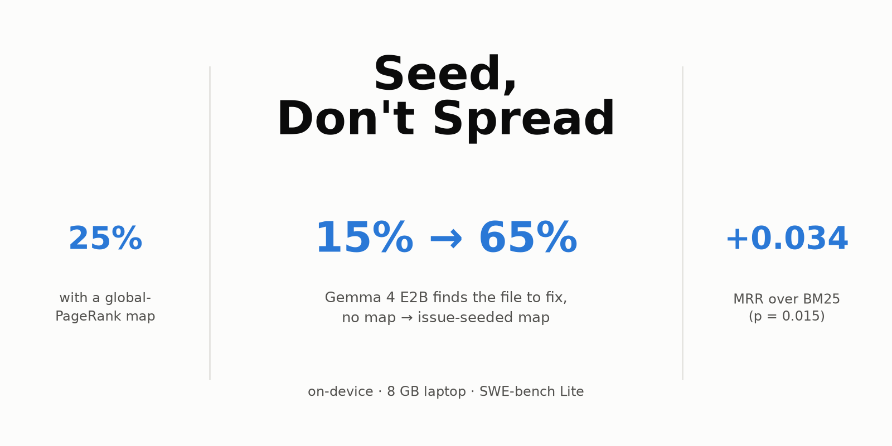

# Seed, Don't Spread

**What a small on-device model needs to see of a repository.** Paper and code for the Google Gemma 4 Developer Agent Paper Track (Kaggle).



Offline coding agents cannot read a whole repository, so the "repo map" they see first decides what they can fix. This repo:

- builds Python code graphs (files, classes, functions, imports, references) for all 300 SWE-bench Lite snapshots straight from git objects;
- ranks files seven ways (tree, BM25, global PageRank, issue seeds, personalized PageRank, and two fusions);
- renders maps to an exact Gemma 4 token budget;
- measures Gemma 4 E2B and E4B (4-bit MLX) localizing the file to fix, all on one 8 GB laptop.

Paper: [`paper/writeup.md`](paper/writeup.md). Every number in it comes from [`results/analysis.md`](results/analysis.md).

## Results

| | |
|---|---|
| Gemma 4 E2B top-1 file accuracy, no map → seed+bm25 signature map (2k tokens) | **15% → 65%** (n = 100) |
| Same model with a global-PageRank map (Aider-style centrality) | 25% |
| Ranker MRR on SWE-bench Lite test, seed+bm25 vs BM25 (selected on disjoint SWE-bench dev) | 0.642 vs 0.608, p = 0.015 |
| Personalized-PageRank "spreading" vs not spreading, on dev and test | always worse |
| 500-token vs 4,000-token map (E2B Acc@1 / latency) | 0.67 / 3.8 s vs 0.64 / 10.6 s |
| Gemma 4 E4B vs E2B (n = 100) | no map: 0.27 vs 0.15; seed+bm25 map: 0.70 vs 0.65 (n.s.) at 3.5× the latency |

The recipe: condition the map on the issue, use the code graph as a symbol index rather than diffusing relevance over it, show signatures, and spend about 500 tokens.

## Reproduce

```bash
uv sync
bash scripts/clone_repos.sh            # bare clones of the 12 Lite repos (--dev adds the 6 dev repos)
uv run python scripts/build_snapshots.py   # code graphs -> cache/graphs (about 30 min on a laptop CPU)
uv run python scripts/eval_rankers.py      # Table 1 + visibility (no LLM)
SS_DATASET=princeton-nlp/SWE-bench SS_SPLIT=dev SS_TAG=dev uv run python scripts/tune.py   # dev selection
uv run python scripts/eval_llm.py mlx-community/gemma-4-e2b-it-4bit 100 \
    none/none/0,seed+bm25/sigs/2000,bm25/sigs/2000,pagerank/sigs/2000   # Apple silicon, MLX
uv run python scripts/hub_bias.py && uv run python scripts/hybrid.py gemma-4-e2b-it-4bit
uv run python scripts/analyze.py && uv run python scripts/figures.py
```

Per-task outputs for every run are committed in `results/`, so `analyze.py` and `figures.py` reproduce all tables and figures without re-running anything.

The public Kaggle notebook, [`notebooks/seed_and_spread_kaggle.ipynb`](notebooks/seed_and_spread_kaggle.ipynb), rebuilds a 60-task subset of the snapshots on a Kaggle CPU and checks that the ranks match the committed ones exactly.

## Layout

- `seedspread/`: library code. `repo.py` reads snapshots from git, `graph.py` builds the AST code graph, `rank.py` holds the rankers, `render.py` renders budgeted maps, `tasks.py` loads the tasks.
- `scripts/`: experiments, analysis and figures.
- `results/`: per-task JSONL for every experiment, plus `analysis.md`.
- `paper/`: the writeup, figures and cover.

No SWE-bench data is redistributed: tasks are loaded from Hugging Face and repositories are cloned from GitHub.

## License

Apache-2.0
