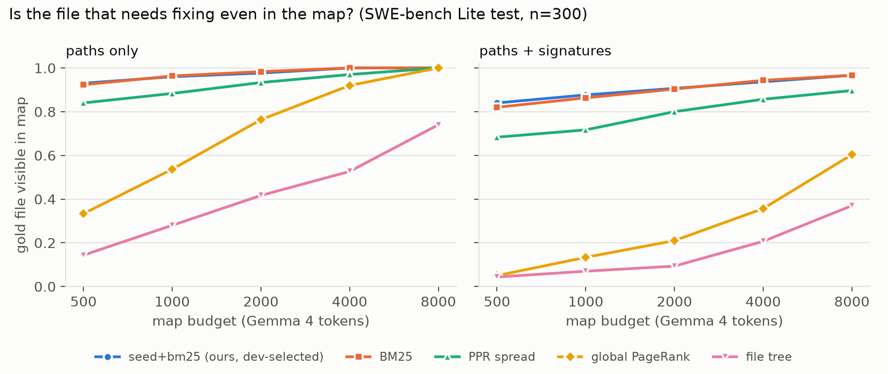
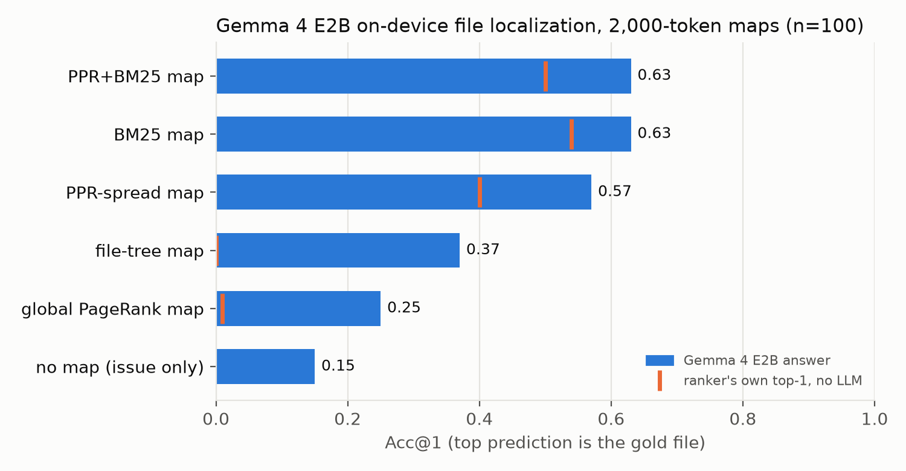
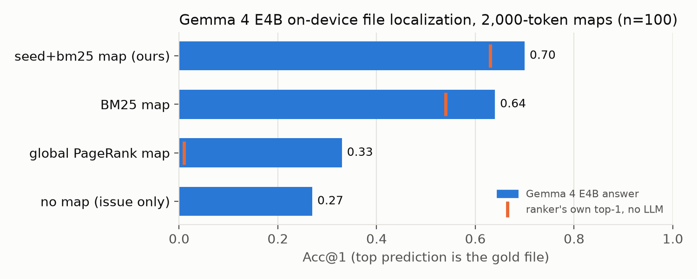
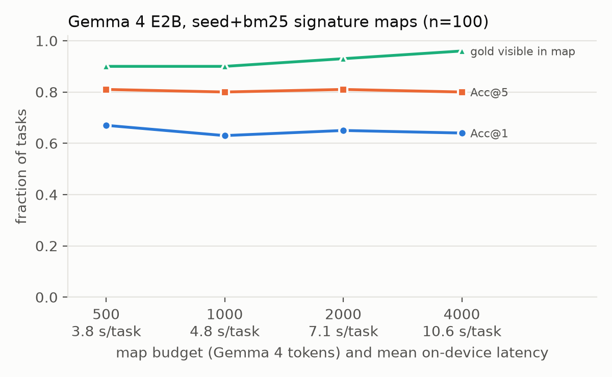

# Seed, Don't Spread: What a Small On-Device Model Needs to See of a Repository

### A token-budgeted repo-map benchmark on SWE-bench Lite, measured with Gemma 4 running on an 8 GB laptop

## Abstract

Offline coding agents cannot read a whole repository, so what they see first decides what they can fix. We study file localization when a small model gets only a *k*-token "repo map" with the issue. We release a standard-library-only toolkit that builds code graphs for all 300 SWE-bench Lite snapshots from git objects, ranks files seven ways, and renders maps to an exact Gemma token budget. We run Gemma 4 E2B and E4B locally on an 8 GB laptop. **(1) Conditioning matters most:** issue-conditioned maps lift Gemma 4 E2B from 15% to 65% top-1 accuracy. A global-PageRank map, as used by popular agents, scores 25%. **(2) Seed, don't spread:** propagating relevance over the code graph with personalized PageRank consistently hurts. Using the graph as a symbol index and fusing it with BM25 is best on a disjoint dev split and lifts test MRR from 0.608 to 0.642 (p = 0.015). **(3) Small budgets suffice:** 500 tokens of signatures match 4,000 at a third of the latency. Once the map is good, the model, not the map, is the bottleneck. Gemma 4 E4B knows more without a map (27% vs 15%), but with a good map it is within noise of E2B (70% vs 65%) at 3.5× the latency.

## 1. Introduction

A coding agent can only fix what it can find. Cloud agents locate bugs with long contexts and many tool calls. A model on a laptop cannot: prefill costs seconds per thousand tokens, and small models are easily distracted.

The standard remedy is a *repo map*, a compact listing of files and perhaps signatures placed in the prompt. Agents build these maps in different ways: global PageRank over a reference graph (Aider), lexical retrieval (Agentless-style BM25), or a plain directory tree. With only a few thousand tokens to spend, that choice determines what a small model can see.

We ask: **given k tokens, which map lets a small on-device model find the file that must change?** We expected issue-seeded graph *propagation* to win. It did not, and that negative result is our most useful finding. Contributions:

1. **A budgeted-localization benchmark and toolkit** (Apache-2.0): 300 snapshots read from bare git clones, an `ast` file/symbol graph, seven rankers, two layouts, exact Gemma-token budgets, and a model-free *visibility ceiling* (is the gold file in the map at all?).
2. **A controlled study of graph use:** in a 24-variant grid selected on a disjoint dev split, propagation never beats seeding alone. The dev-selected `seed+bm25` is the best ranker on test.
3. **On-device measurements** with Gemma 4 E2B and E4B of accuracy, visibility, prompt size and latency across maps, layouts and budgets.

## 2. Related work

**Repository-level localization.** SWE-bench (Jimenez et al., 2024) is the standard benchmark for issue resolution, and SWE-bench Lite its 300-task subset. SWE-agent (Yang et al., 2024) and AutoCodeRover (Zhang et al., 2024) localize interactively. Agentless (Xia et al., 2025) showed a fixed localize-then-repair pipeline is competitive. We isolate its first, file-level step for models small enough to run offline.

**Code graphs for LLMs.** RepoGraph (Ouyang et al., 2025), CodexGraph (Liu et al., 2025) and LocAgent (Chen et al., 2025) give large models graph-structured access to repositories, typically via multi-step traversal. Aider ranks definitions with PageRank and packs them into a token budget (Gauthier, 2023). We keep budgeted packing, compare global against issue-personalized walks, and target models that cannot afford many tool calls.

**Seeded propagation.** Personalized PageRank (Page et al., 1999; Haveliwala, 2002) biases a random walk toward a restart set. HippoRAG (Gutiérrez et al., 2024) seeds PPR with query entities for multi-hop QA. We test the same idea on code and find it does not transfer to file localization. Reciprocal rank fusion (Cormack et al., 2009) is our fusion operator.

**Context and small models.** Models use mid-context information unreliably (Liu et al., 2024), so short, well-ranked contexts matter for small models such as Gemma 4 (Gemma Team, 2026).

## 3. Method

### 3.1 Snapshots and code graph

Each task pins a repository to a base commit. We read snapshots from bare clones (`git ls-tree` plus one `git cat-file --batch` stream), with no checkouts. Candidates are Python files outside test, docs and example directories. In SWE-bench Lite the gold patch never edits tests, and the gold file is a candidate in 300/300 tasks.

We parse files with Python's `ast`. Nodes are files and their classes, functions and methods, each with a one-line signature. Edges are **contains** (both directions), **imports** (resolved by longest module prefix, including relative imports) and **references**: each name used inside a definition links to all definitions of that name, weight 1/k, with names defined more than 50 times dropped. Resolution is approximate (no types), which keeps construction to seconds per snapshot and dependency-free. Median snapshot: 702 files, 9,432 symbols and 139k edges (max 863 files, 29k symbols, 1.16M edges). 15 of 168,597 file snapshots were skipped (syntax errors or pathological nesting).

### 3.2 Seeds: the graph as an index

Issues name things. We map issue text onto graph nodes in three ways:

1. any `*.py` path matching a repository file (weight 3);
2. dotted module paths resolved to the longest matching module, plus the trailing symbol if defined there (weight 2);
3. identifiers (three or more characters, not stopwords) that name definitions: each of the k definitions gets `log(N/k) · log(1 + mentions) / k`, where N is the number of symbols in the repository.

Rare names (`separability_matrix`) dominate, and common ones (`save`) barely count. The **seed** ranker scores a file by its own seed weight plus its best symbol's.

### 3.3 Spreading (the hypothesis we rejected)

**ppr** runs personalized PageRank with the seeds as the restart distribution, x = α(Mx + d·v) + (1−α)v, and aggregates node mass to files. We grid α ∈ {0.2, 0.5, 0.8}, optional normalization by global PageRank (to remove hub bias), file aggregation (file mass + best symbol, or best symbol only) and optional fusion with BM25: 24 variants.

### 3.4 Baselines and the selected ranker

**tree** lists paths alphabetically. **pagerank** is global PageRank over the same graph (Aider-style centrality). **bm25** is Okapi BM25 over file contents and paths with identifier splitting. **ppr+bm25** adds BM25's top 10 to the PPR restart set. **seed+bm25** is reciprocal rank fusion (k = 60) of the BM25 and seed rankings, chosen by MRR on the dev split (§4.1).

### 3.5 Budgeted rendering

Files are rendered in rank order as **paths** (one per line) or **sigs** (path plus up to eight top-level signatures, with seeded methods first). Rendering stops before the Gemma-tokenized map would exceed k tokens, and a file whose signatures don't fit falls back to its bare path.

## 4. Experiments

**Data.** We report on SWE-bench Lite test (300 tasks, 12 repositories). For selection we use the SWE-bench **dev** split: 225 tasks from 6 repositories absent from test. Every Lite task edits one non-test file, so we report **Acc@k** and **MRR**.

**Models.** Gemma 4 E2B-it and E4B-it, 4-bit MLX (`mlx-community/gemma-4-e{2,4}b-it-4bit`), on an Apple laptop with 8 GB of unified memory, greedy decoding, thinking off. The prompt holds the issue (up to 6,000 characters), the map, and a request for the five most likely files. Paths are matched exactly or by unique suffix. Every condition uses the same fixed, repo-stratified sample of 100 test tasks. Intervals are 95% bootstrap, and comparisons are paired bootstrap tests over tasks.

### 4.1 Selecting a ranker on dev: spreading never helps

On dev (n = 223 with a non-test gold file), the best of 24 propagation variants reaches MRR 0.677. That ties plain BM25 (0.676) and trails `rrf(bm25, seed)` (0.714). Unfused, every PPR variant (0.548–0.622) is below seeds alone (0.649). Longer walks are worst: mean MRR is 0.611, 0.611 and 0.586 for α = 0.2, 0.5 and 0.8. Global-PageRank normalization does not close the gap. We select **seed+bm25**.

After selection we also ran all 24 variants on test, and the picture is unchanged. Unfused PPR scores 0.421–0.469, below seeds alone (0.497), with α = 0.8 again worst. Fused variants score 0.593–0.620, below seed+bm25 (0.642).

### 4.2 Rankers on test (no LLM)

| ranker | Acc@1 | Acc@5 | Acc@10 | MRR [95% CI] |
|---|---|---|---|---|
| tree | 0.000 | 0.017 | 0.030 | 0.016 [0.011, 0.023] |
| global PageRank | 0.020 | 0.037 | 0.060 | 0.046 [0.031, 0.063] |
| ppr (α=0.5) | 0.310 | 0.637 | 0.697 | 0.452 [0.409, 0.496] |
| seed | 0.357 | 0.673 | 0.757 | 0.497 [0.450, 0.544] |
| ppr+bm25 | 0.457 | 0.740 | 0.823 | 0.584 [0.539, 0.631] |
| bm25 | 0.487 | 0.763 | 0.823 | 0.608 [0.564, 0.654] |
| **seed+bm25** | **0.527** | **0.773** | **0.847** | **0.642** [0.597, 0.684] |

*Table 1. File ranking on SWE-bench Lite test (n = 300).*

The dev ordering holds on test. seed+bm25 beats BM25 by +0.034 MRR (p = 0.015) and +4.0 points Acc@1 (p = 0.06). It ties or wins in 9 of 12 repositories (largest gains: sympy 0.59→0.66 and matplotlib 0.52→0.57). It loses on sphinx (0.68→0.59), where issues describe behavior rather than naming code. Global PageRank places the gold file first in only 2% of tasks: centrality says what is important to the repository, not to the issue.

**Why spreading hurts: centrality bias.** We rank every file by global PageRank and look at the centrality percentile of each ranker's *wrong* top-1 picks. Gold files are moderately central (median 79th percentile). BM25's mistakes look the same (79th; 12% fall in the 5% most central files). Graph-derived rankers err toward hubs: seed mistakes sit at the 90th percentile (26% in the top 5%), and spreading pushes this further, to the 91st (30%). Popular names are defined in, and referenced from, core modules, so every hop of the walk drifts toward them. BM25 is indifferent to centrality and corrects this bias when fused, which explains why seed+bm25 beats both of its parts.

### 4.3 Visibility under a budget

*Figure 1. Fraction of tasks whose gold file appears in the map, by ranker, layout and budget (Gemma 4 tokens).*

Visibility caps what any model can do with a map, and it separates the strategies clearly (Figure 1). With issue-conditioned rankers, a **paths-only** map shows the gold file in 92–93% of tasks at 500 tokens and 98% at 2,000. Signatures cost space: at 2,000 tokens, seed+bm25 signature maps show it in 91% of tasks, and they need 8,000 tokens to reach 97%. Repository-centric maps are far worse. A 2,000-token global-PageRank signature map shows the gold file in only 21% of tasks, and an alphabetical tree in 9%. Even 8,000 tokens of tree paths cover only 74% of these repositories. PPR spreading loses visibility relative to seeds alone at every budget (signatures at 2,000: 0.80 vs 0.87).

### 4.4 Gemma 4 on device

*Figure 2. Gemma 4 E2B Acc@1 with 2,000-token maps (bars) and the top-1 accuracy of the ranker that built each map, without an LLM (ticks). Same 100 tasks in every condition.*

| map (2,000 tokens) | Acc@1 [95% CI] | Acc@5 | gold in map | Acc@1 if gold in map | ranker's own Acc@1 | prompt tok. | s/task |
|---|---|---|---|---|---|---|---|
| none (issue only) | 0.15 [0.08, 0.22] | 0.20 | – | – | – | 566 | 2.3 |
| global PageRank, sigs | 0.25 [0.17, 0.34] | 0.35 | 0.23 | 0.52 | 0.01 | 2,577 | 6.0 |
| tree, paths | 0.37 [0.28, 0.47] | 0.49 | 0.47 | 0.51 | 0.00 | 2,369 | 5.6 |
| ppr, sigs | 0.57 [0.47, 0.67] | 0.75 | 0.85 | 0.67 | 0.40 | 2,576 | 6.4 |
| bm25, paths | 0.54 [0.44, 0.64] | 0.75 | 0.99 | 0.55 | 0.54 | 2,370 | 6.3 |
| bm25, sigs | 0.63 [0.54, 0.72] | 0.78 | 0.93 | 0.68 | 0.54 | 2,577 | 6.8 |
| ppr+bm25, sigs | 0.63 [0.53, 0.72] | 0.79 | 0.94 | 0.67 | 0.50 | 2,577 | 6.5 |
| seed+bm25, paths | 0.56 [0.46, 0.66] | 0.77 | 0.97 | 0.58 | 0.63 | 2,370 | 6.3 |
| **seed+bm25, sigs** | **0.65** [0.55, 0.74] | **0.81** | 0.93 | 0.70 | 0.63 | 2,577 | 7.1 |

*Table 2. Gemma 4 E2B (4-bit, 8 GB laptop) on the same 100 tasks per row.*

**Conditioning is most of the effect.** Without a map, Gemma 4 E2B names the right file 15% of the time. It mostly invents plausible paths that do not exist: of the 279 paths it named without a map, only 58 (21%) exist in the repository, and 67 of 100 answers contained no real file at all. Any issue-conditioned map brings it to 0.57–0.65. The global-PageRank map, the same graph ranked by centrality, adds 10 points and is 40 points below seed+bm25 (paired p < 0.001). Its gold file is visible only 23% of the time, and an invisible file cannot be chosen.

**Signatures beat coverage.** Paths-only maps show the gold file *more* often than signature maps (0.97–0.99 vs 0.93). Yet signatures raise Acc@1 by 9 points for both seed+bm25 (p = 0.001) and BM25. Seeing what a file defines matters more to the model than seeing more files.

**The model re-ranks weak maps but not strong ones.** On the same tasks, Gemma's top-1 beats the top-1 of the ranker that built its map: PPR 0.40→0.57 (p = 0.001), ppr+bm25 0.50→0.63 (p = 0.006), BM25 0.54→0.63 (p = 0.04). With seed+bm25 the gain shrinks to 0.63→0.65 (p = 0.41), and the model's five-file list (Acc@5 0.81) is *worse* than the ranker's own top five (0.86). Whatever the map, model accuracy converges to 0.57–0.67, and to 0.67–0.70 when the gold file is visible. Once the map is good, the 2B model's judgment, not its view, is the bottleneck. An untuned hybrid that puts the model's top-1 first and then follows the ranker recovers the best of both: Acc@5 0.87 for seed+bm25, vs 0.86 for the ranker and 0.81 for the model. Model-level differences among bm25, ppr+bm25 and seed+bm25 are within noise at n = 100 (p ≥ 0.26); the n = 300 ranker comparison (§4.2) is more reliable.

**A bigger model does not replace a good map.** Gemma 4 E4B nearly doubles E2B's no-map accuracy (0.27 vs 0.15, p = 0.003), but a good map adds far more than model size: seed+bm25 lifts E4B to 0.70, while E4B's gain over E2B with that map is 0.05 (p = 0.12), at 25 s per task vs 7 s. E2B with a seed+bm25 map beats E4B with a PageRank map (0.65 vs 0.33). E4B does separate the rankers: seed+bm25 beats BM25 by 6 points (p = 0.045) and its top-1 beats the ranker's own (0.70 vs 0.63).

### 4.5 How many tokens does a small model need?

*Figure 3. Gemma 4 E2B with seed+bm25 signature maps from 500 to 4,000 tokens (same 100 tasks).*

Very few. Acc@1 is flat across an 8× range of budgets: 0.67, 0.63, 0.65 and 0.64 at 500, 1,000, 2,000 and 4,000 tokens (500 vs 2,000: p = 0.80). Visibility rises from 0.90 to 0.96, but the extra files are rarely the ones the model needed. Latency, however, nearly triples, from 3.8 s to 10.6 s per task, because prefill dominates on a laptop. For an on-device agent the recommendation is concrete: **a 500-token, issue-seeded signature map gets all of the accuracy at a third of the cost.**

## 5. Discussion

**What to build into a small coding agent.** A recipe for on-device localization: (i) Condition the context on the issue. Repository-centric summaries (directory trees, centrality-ranked maps) waste most of a small model's budget. (ii) Use the code graph as a *symbol index*: which names are defined where, and how rare they are. Fuse it with lexical retrieval, and do not diffuse relevance over references. (iii) Show signatures, not just paths. (iv) Spend about 500 tokens, not 4,000. On an 8 GB laptop this takes the step from about 11 s to about 4 s with no loss of accuracy.

**Why diffusion fails here, and where it may not.** PPR suits multi-hop QA, where answers lie *between* query entities. In SWE-bench Lite the file to edit usually defines what the issue names, so every hop moves mass from that definition toward core modules (the hub bias of §4.2). We expect propagation to matter more for multi-file changes and for issues that describe symptoms without naming code (sphinx, where all graph rankers trail BM25). SWE-bench Verified and multi-file benchmarks are the natural next test.

**Generality.** Nothing here is specific to SWE-bench or Gemma: snapshots come from any git history. The graph needs only definitions and references (tree-sitter would extend it beyond Python). Budgets use the target model's tokenizer. The visibility ceiling is model-free and runs on all 300 tasks in minutes on a CPU, which makes it a cheap first filter for any context-construction method.

**Limitations.** We study file-level localization only, not patch generation or end-to-end resolution. All tasks are Python and single-file. Name resolution is untyped. LLM results use 100 tasks per condition, so differences under about 10 points are within noise. SWE-bench issues may appear in model pre-training data. This affects all conditions equally, and the no-map baseline (15%) bounds how much the model can recall.

## 6. Reproducibility

All code, per-task outputs and the scripts that produce every table and figure are at **github.com/shineyrbl-byte/seed-and-spread** (Apache-2.0), mirrored in a public Kaggle notebook. Pipeline: `build_snapshots.py` → `eval_rankers.py` / `tune.py` → `eval_llm.py` → `analyze.py` / `figures.py`. Building all 300 graphs takes about 30 minutes on a laptop CPU. Each 100-task LLM condition takes about 10–20 minutes on the 8 GB laptop.

## References

* Chen, Z. et al. (2025). LocAgent: Graph-Guided LLM Agents for Code Localization. ACL 2025.
* Cormack, G. V., Clarke, C. L. A., Büttcher, S. (2009). Reciprocal Rank Fusion outperforms Condorcet and individual rank learning methods. SIGIR 2009.
* Gauthier, P. (2023). Building a better repository map with tree-sitter. aider.chat.
* Gemma Team, Google DeepMind (2026). Gemma 4 model card. ai.google.dev/gemma/docs/core/model_card_4.
* Gutiérrez, B. J. et al. (2024). HippoRAG: Neurobiologically Inspired Long-Term Memory for Large Language Models. NeurIPS 2024.
* Haveliwala, T. (2002). Topic-sensitive PageRank. WWW 2002.
* Jimenez, C. E. et al. (2024). SWE-bench: Can Language Models Resolve Real-World GitHub Issues? ICLR 2024.
* Liu, N. F. et al. (2024). Lost in the Middle: How Language Models Use Long Contexts. TACL.
* Liu, X. et al. (2025). CodexGraph: Bridging Large Language Models and Code Repositories via Code Graph Databases. NAACL 2025.
* Ouyang, S. et al. (2025). RepoGraph: Enhancing AI Software Engineering with Repository-level Code Graph. ICLR 2025.
* Page, L., Brin, S., Motwani, R., Winograd, T. (1999). The PageRank Citation Ranking: Bringing Order to the Web. Stanford InfoLab.
* Robertson, S., Zaragoza, H. (2009). The Probabilistic Relevance Framework: BM25 and Beyond. FnTIR.
* Xia, C. S., Deng, Y., Dunn, S., Zhang, L. (2025). Demystifying LLM-based Software Engineering Agents (Agentless). FSE 2025. arXiv:2407.01489.
* Yang, J. et al. (2024). SWE-agent: Agent-Computer Interfaces Enable Automated Software Engineering. NeurIPS 2024.
* Zhang, Y. et al. (2024). AutoCodeRover: Autonomous Program Improvement. ISSTA 2024.
